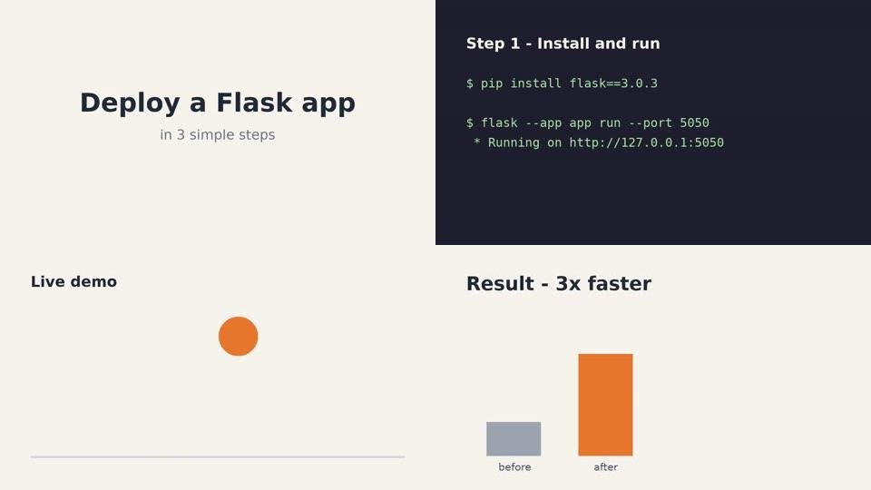
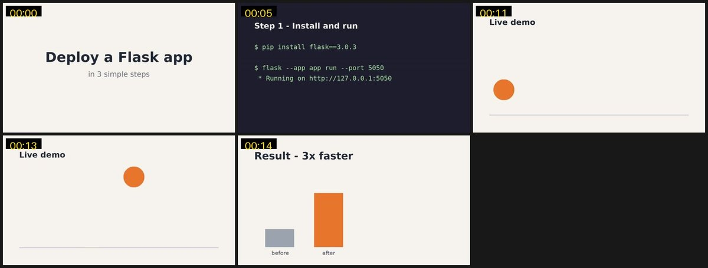
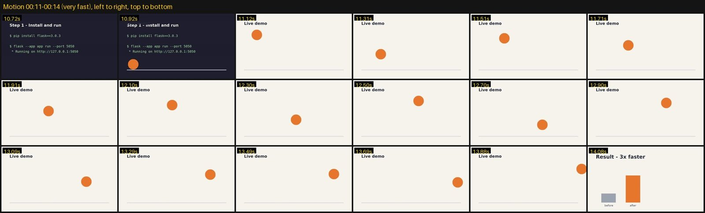
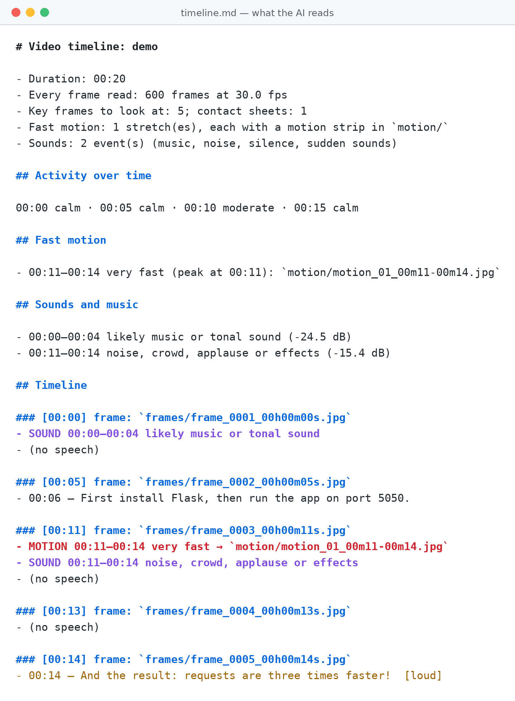

# video-watch

**Let any AI agent watch a video, and learn new skills from it.**

Give your AI agent a video link. It sees every frame, hears the audio, and can answer questions
about the video or turn what the video teaches into a new skill it can reuse.

Works with **Claude Code, Codex, Gemini CLI, Cursor** and other agents. Free, runs on your
computer, no API keys.


---

## 1. Install (one command)

**Mac / Linux**

```bash
curl -fsSL https://raw.githubusercontent.com/vamsireddy4/agent-video-skill/main/install.sh | sh
```

**Windows (PowerShell)**

```powershell
irm https://raw.githubusercontent.com/vamsireddy4/agent-video-skill/main/install.py | python -
```

That's it. It finds your AI agents, installs everything they need (no admin password), and tells
you when it's ready:


> You only need **Python 3.9+**. Then start a new session in your AI agent.

---

## 2. Use it

Type one of these in your AI agent:

| Type this | What happens |
|---|---|
| `/video-watch <link>` | Watches the whole video, **learns it and creates a new skill** |
| `/video-watch ask <link> <question>` | Answers your question about the video |
| `/video-watch summary <link>` | Gives a summary with timestamps |

Or just ask in your own words: *"Watch this video and tell me what code they wrote at 5:30"*.

> Some agents use a different prefix (Codex, for example, uses `$video-watch`).

---

## 3. What the AI sees

Here is a 20-second demo video:



**Key frames.** Every frame is read, and the important ones are picked for the AI: each new
slide, new line of code, scene change and moment of action.



**Fast motion, frame by frame.** When something moves fast, the AI gets a strip of frames so it can
follow the movement.



**A timeline it can read.** Pictures, speech, music, sounds and tone, all lined up by time.



---

## 4. Learn a skill from a video

`/video-watch <link>` watches a tutorial, learns the steps, writes a new skill, tests it, and shows
you this card, so you know the skill was really created:


Use the new skill like any other: type `/flask-health-api`, or just ask for the task.

See every skill you have learned from videos:

```bash
python3 ~/.claude/skills/video-watch/scripts/scaffold_skill.py --list
```

---

## 5. Any language

The AI listens to the audio, not just captions, in about **100 languages**: Telugu, Hindi, Tamil,
Kannada, Malayalam, English, Spanish and more. Mixed speech like Tenglish or Hinglish works too.
It can add an English translation of every line.

---

## Update / Uninstall

**Update:** run the install command again.

**Uninstall:**

```bash
curl -fsSL https://raw.githubusercontent.com/vamsireddy4/agent-video-skill/main/install.sh | sh -s -- --uninstall
```

Skills you learned from videos are kept. Delete them yourself if you don't need them.

---

## Good to know

- **The AI looks at the best frames, not all of them.** Every frame is measured on your computer,
  but sending thousands of images to an AI would be slow and costly.
- **Music, sound and tone are hints.** "Likely music" or "[loud, fast]" come from measuring the
  audio, so treat them as clues, not facts.
- **Netflix, Prime Video, Hotstar and other DRM videos can't be watched.**
- **YouTube not working?** Run the install command again to update. If it still fails, install
  [Deno](https://deno.com) or Node.js.
- Respect each site's rules and the creator's rights.

---

<details>
<summary><b>Install with git instead</b></summary>

Clone into your agent's skills folder:

```bash
git clone https://github.com/vamsireddy4/agent-video-skill ~/.claude/skills/video-watch
```

| Agent | Folder |
|---|---|
| Claude Code | `~/.claude/skills/video-watch` |
| Codex, GitHub Copilot | `~/.agents/skills/video-watch` |
| Gemini CLI | `~/.gemini/skills/video-watch` |
| Cursor | `~/.cursor/skills/video-watch` |

Setup then happens automatically the first time you use `/video-watch`. You can also run
`python3 install.py` inside the folder. Installer options: `--agents claude,codex`,
`--no-models` (skip downloading speech models now), `--uninstall`.

</details>

<details>
<summary><b>Run it yourself (advanced options)</b></summary>

```bash
python3 scripts/video_watch.py "<link or file>" -o out
```

| Option | What it does |
|---|---|
| `--start 10:00 --end 12:00` | Only that part of the video |
| `--quick` | Faster: skip reading every frame |
| `--max-frames 60` | Let the AI see more key frames (default 40) |
| `--motion-fps 15 --motion-frames 30` | Denser motion strips for very fast action |
| `--transcript audio` | Always listen to the audio (best for non-English) |
| `--translate` | Add an English translation of the speech |
| `--lang te` | Tell it the spoken language |
| `--whisper-model-other medium` | More accurate (slower) listening for non-English |
| `--transcript captions` | Captions only, never listen (fastest) |
| `--no-audio-analysis` | Skip music, sound and tone |
| `--cookies-from-browser chrome` | For videos that need your login |
| `--check` | Check that everything is installed |

What you get in `out/`:

| File | What it is |
|---|---|
| `timeline.md` | Read this first: frames, speech, motion and sounds by time |
| `frames/` | Key frames, named by time |
| `motion/` | Motion strips for the fast parts |
| `sheets/` | Several frames per image |
| `transcript.txt` | Everything that was said |
| `transcript_en.txt` | English translation (with `--translate`) |
| `timeline.json` | Everything, for programs |

Learn-a-skill tools:

```bash
python3 scripts/scaffold_skill.py my-skill --description "What it does. Use when ..." --agent claude
python3 scripts/scaffold_skill.py --validate <skill folder>
python3 scripts/scaffold_skill.py --card <skill folder>
python3 scripts/scaffold_skill.py --list
```

</details>

<details>
<summary><b>How it works inside</b></summary>

1. **Find the video.** Links go through `yt-dlp`, which finds the real video stream. Nothing is
   downloaded; the video is streamed.
2. **Read every frame.** One fast pass reads every frame at low resolution and measures motion and
   changes (about 15,000 frames of a 10-minute video in under 20 seconds).
3. **Pick key frames.** Full-size frames are taken at every new slide, code line, scene change and
   motion peak, plus evenly spread frames so nothing long is missed. Fast parts become motion
   strips.
4. **Listen.** Captions are used if the creator added them; otherwise Whisper listens to the audio
   and detects the language. Loudness, pitch and speed give tone hints; silence, music and noise
   are marked.
5. **Timeline.** Everything is lined up by time in `timeline.md` for the AI to read. Pictures and
   sound are processed at the same time to keep it fast.

</details>

## License

MIT, see [LICENSE](LICENSE).
