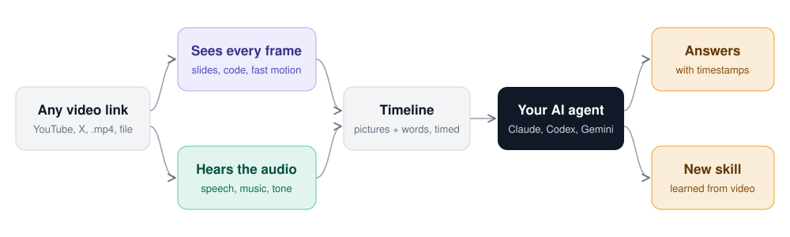
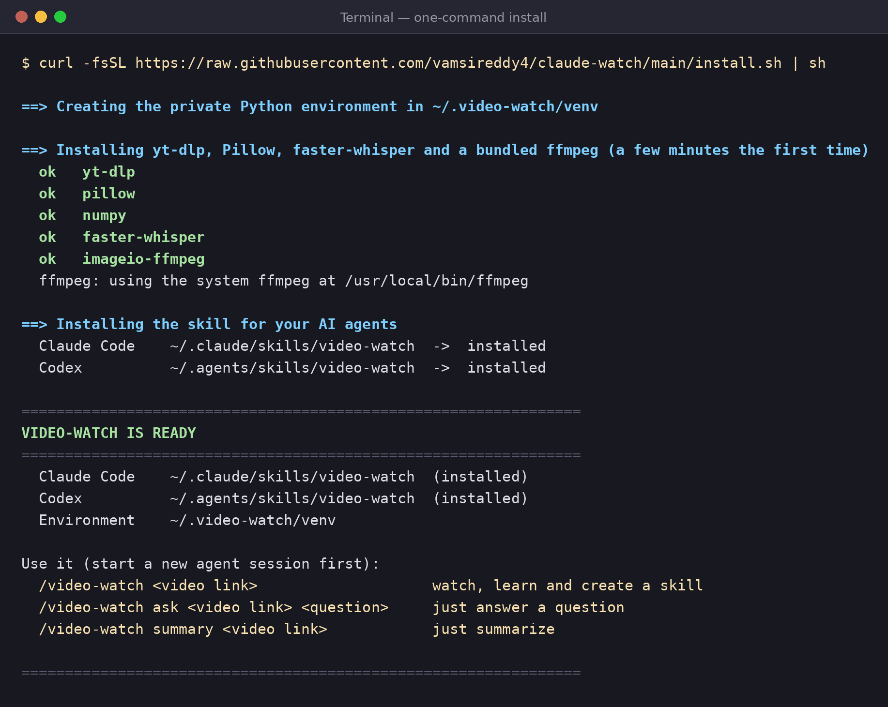
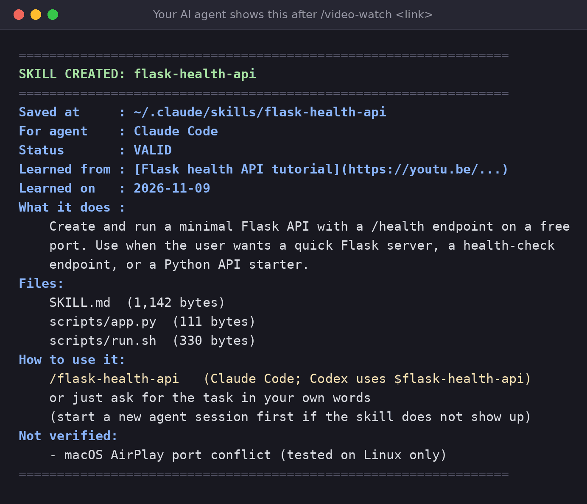

# /video-watch

**Let any AI agent watch a video, and learn new skills from it.**

Give your agent a video link or file. It reads every frame, listens to the audio in about 100
languages, and can answer questions about the video or turn what the video teaches into a new
skill it can reuse. Free, runs on your computer, no API keys.



## Choose your app

| Where you use your agent | Start here |
|---|---|
| **Claude Code** (terminal, desktop app, VS Code) | [Install for Claude Code](#claude-code) |
| **Codex** (CLI, desktop app, IDE) | [Install for Codex](#codex) |
| **Gemini CLI** | [Install for Gemini CLI](#gemini-cli) |
| **Cursor, GitHub Copilot or another agent** | [Install for other agents](#other-agents) |
| **Claude chat, ChatGPT, Gemini web, or other browser apps** | [Not supported](#chat-and-browser-apps) |

All of them use the same one-command installer. It finds the agents on your computer and installs
the skill for each one, plus everything the skill needs (no admin password).

### Claude Code

Run this **in your computer's terminal**:

```bash
curl -fsSL https://raw.githubusercontent.com/vamsireddy4/claude-watch/main/install.sh | sh
```

On Windows, use PowerShell:

```powershell
irm https://raw.githubusercontent.com/vamsireddy4/claude-watch/main/install.py | python -
```

You'll see this when it's done:



Start a new Claude Code session and type `/video-watch`.

### Codex

Run the same command as above in your terminal. The skill goes into `~/.agents/skills/video-watch`,
the shared folder Codex reads. Start a new Codex session and type `$video-watch`, or ask:
*"Use the video-watch skill on this link"*.

### Gemini CLI

Run the same command as above. If you have Gemini CLI installed (a `~/.gemini` folder), the skill
goes into `~/.gemini/skills/video-watch`. Start a new session and ask: *"Use the video-watch skill
on this link"*.

### Other agents

Run the same command as above. If your agent isn't detected, choose where to install:

```bash
curl -fsSL https://raw.githubusercontent.com/vamsireddy4/claude-watch/main/install.sh | sh -s -- --agents agents
```

`agents` installs into `~/.agents/skills/video-watch`, which Copilot, Codex and many other agents
read. Use `--agents cursor` for Cursor. If your agent reads skills from somewhere else, copy the
whole `video-watch` folder there. Keep `SKILL.md` and the `scripts/` folder together.

### Chat and browser apps

**Not supported:** Claude chat (claude.ai), ChatGPT, Gemini web and other browser apps. The skill
has to run programs (ffmpeg, yt-dlp, Whisper) on a computer that can reach video sites. Browser
apps run code in a cloud sandbox that usually can't reach YouTube and similar sites, and their
setup doesn't persist. Use a local agent from the table above.

## Try your first video

1. Start a new session in your agent.
2. Paste this into the message box (use any short public video):

```text
/video-watch summary https://www.youtube.com/watch?v=YOUR_VIDEO
```

3. The first time, the agent checks its tools. If anything is missing, it sets it up itself
   (2-5 minutes, one time).

**Success looks like a summary with timestamps.** Next, try asking a question:

```text
/video-watch ask https://www.youtube.com/watch?v=YOUR_VIDEO what code is on screen at 2:30?
```

Then try learning a skill from a tutorial:

```text
/video-watch https://www.youtube.com/watch?v=A_TUTORIAL
```

## Commands

| Type this | What happens |
|---|---|
| `/video-watch <link>` | Watches the whole video, **learns it and creates a new skill** |
| `/video-watch ask <link> <question>` | Answers your question about the video |
| `/video-watch summary <link>` | Gives a summary with timestamps |

A link can be YouTube, Vimeo, X, Instagram, TikTok, a news site, a direct `.mp4` / `.m3u8`, or a
file on your computer. You can also just ask in your own words. In Codex, use `$video-watch`.

## Learn a skill from a video

`/video-watch <link>` watches a tutorial from start to end, learns the steps, writes a new skill,
tests it, and shows you this card, so you know the skill was really created:



Use the new skill like any other: type `/flask-health-api`, or just ask for the task. If something
goes wrong, the agent says **"Skill was NOT created"** and why.

See every skill you have learned from videos:

```bash
python3 ~/.claude/skills/video-watch/scripts/scaffold_skill.py --list
```

## Merge several skills into one

Learned 5 SEO skills from 5 SEO videos? **merge-skills** combines them into one SEO skill. The agent
reads every skill in full, removes duplicates, keeps the unique tips, asks you about conflicts, and
gives you one clean skill.

Install it once (Claude Code):

```bash
cp -r skills/merge-skills ~/.claude/skills/merge-skills
```

Then just ask:

```text
Merge all my SEO skills into one.
```

Or name them: `Merge seo-keywords, seo-onpage, seo-content, seo-technical and seo-backlinks into one SEO skill.`

The old skills are **not deleted automatically**. Save the merged skill first, then remove the old
ones. Full guide: [skills/merge-skills/README.md](skills/merge-skills/README.md).

## Languages

The AI listens to the audio, not just captions, in about **100 languages**: Telugu, Hindi, Tamil,
Kannada, Malayalam, English, Spanish and more. The language is detected automatically, and mixed
speech like Tenglish or Hinglish works too.

| Want | Add to your request |
|---|---|
| An English translation of every line | "with English translation" (or `--translate`) |
| A specific language | "the video is in Telugu" (or `--lang te`) |
| Better accuracy for Indian languages | "use the medium speech model" (or `--whisper-model-other medium`) |

## Detail and speed

| Option | What it does |
|---|---|
| *(default)* | Reads every frame, picks up to 40 key frames, makes motion strips, analyses sound |
| `--quick` | Fastest: skips the every-frame scan |
| `--start 10:00 --end 12:00` | Only that part of the video |
| `--max-frames 60` | Lets the AI see more key frames |
| `--motion-fps 15 --motion-frames 30` | Denser motion strips for very fast action |
| `--transcript captions` | Captions only, never listens (fastest) |
| `--no-audio-analysis` | Skips music, sound and tone |

You can say these in plain words too: *"just look at 10:00 to 12:00"*, *"be quick"*.

<details>
<summary>All files the skill creates</summary>

| File | What it is |
|---|---|
| `timeline.md` | Read first: frames, speech, motion and sounds by time |
| `frames/` | Key frames, named by time |
| `motion/` | Motion strips for the fast parts |
| `sheets/` | Several frames per image |
| `transcript.txt` | Everything that was said |
| `transcript_en.txt` | English translation (with `--translate`) |
| `timeline.json` | Everything, for programs |

</details>

## Updating and troubleshooting

**Update:** run the install command again. It updates the skill for every agent and refreshes
yt-dlp, which sites like YouTube need.

**Check your setup:** ask the agent *"run the video-watch check"*, or run:

```bash
python3 ~/.claude/skills/video-watch/scripts/video_watch.py --check
```

| Problem | What to do |
|---|---|
| `/video-watch` doesn't appear | Start a new agent session. Still missing? Run the install command again and check the folder it prints. |
| YouTube says "Sign in to confirm" or 403 | Run the install command again to update yt-dlp. If it still fails, install [Deno](https://deno.com) or Node.js. |
| A video needs your login | Ask the agent to use your browser login (`--cookies-from-browser chrome`). Only for your own account. |
| "No frames could be extracted" | The video is DRM-protected (Netflix, Prime Video, Hotstar), or the site blocks streaming. Try a direct link or a downloaded file. |
| No speech in the result | Run the check. On first use the speech models download from Hugging Face, which needs internet. |
| Wrong language detected | Tell it the language: *"the video is in Telugu"* (`--lang te`). |
| Too slow on a long video | Use `--quick`, or only part of the video with `--start` / `--end`. |
| Python not found | Install Python 3.9+ from [python.org](https://www.python.org/downloads/) and run the installer again. |
| "Skill was NOT created" | Read the reason the agent gives. Usually a missing tool or a video it couldn't open. |

## Uninstall

```bash
curl -fsSL https://raw.githubusercontent.com/vamsireddy4/claude-watch/main/install.sh | sh -s -- --uninstall
```

This removes the skill from every agent and the `~/.video-watch` environment. Skills you learned
from videos are kept; delete them yourself if you don't need them. Speech models stay in
`~/.cache/huggingface` until you delete them.

## Data and privacy

- **On your computer:** the video is streamed and read locally. It is never saved in full, and
  nothing is uploaded to a video-analysis service. No API keys are used.
- **Your agent's AI** sees the selected frames and the transcript, the same way it sees any file
  you share with it.
- **First run** downloads Python packages (PyPI) and speech models (Hugging Face).
- **Output** goes to a `video-watch-<title>` folder where the agent is working. Delete it when you
  are done.
- **Limits:** the AI looks at the best frames, not all of them. Music, sound and tone labels come
  from measuring the audio, so they are hints, not facts. Respect each site's rules and the
  creator's rights.

<details>
<summary>How it works inside</summary>

1. **Find the video.** Links go through `yt-dlp`, which finds the real stream. Nothing is
   downloaded; the video is streamed.
2. **Read every frame.** One fast pass reads every frame at low resolution and measures motion and
   changes (about 15,000 frames of a 10-minute video in under 20 seconds).
3. **Pick key frames.** Full-size frames are taken at every new slide, code line, scene change and
   motion peak, plus evenly spread frames so nothing long is missed. Fast parts become motion
   strips.
4. **Listen.** Creator captions are used if they exist; otherwise Whisper listens and detects the
   language. Loudness, pitch and speed give tone hints; silence, music and noise are marked.
5. **Timeline.** Everything is lined up by time in `timeline.md`. Pictures and sound are processed
   at the same time to keep it fast.

</details>

<details>
<summary>Install with git instead</summary>

```bash
git clone https://github.com/vamsireddy4/claude-watch ~/.claude/skills/video-watch
```

| Agent | Folder |
|---|---|
| Claude Code | `~/.claude/skills/video-watch` |
| Codex, GitHub Copilot | `~/.agents/skills/video-watch` |
| Gemini CLI | `~/.gemini/skills/video-watch` |
| Cursor | `~/.cursor/skills/video-watch` |

Git doesn't run code on clone, so setup happens the first time you use `/video-watch`, or run
`python3 install.py` inside the folder. Installer options: `--agents claude,codex`, `--no-models`,
`--deps-only`, `--uninstall`.

</details>

## License

MIT, see [LICENSE](LICENSE).
